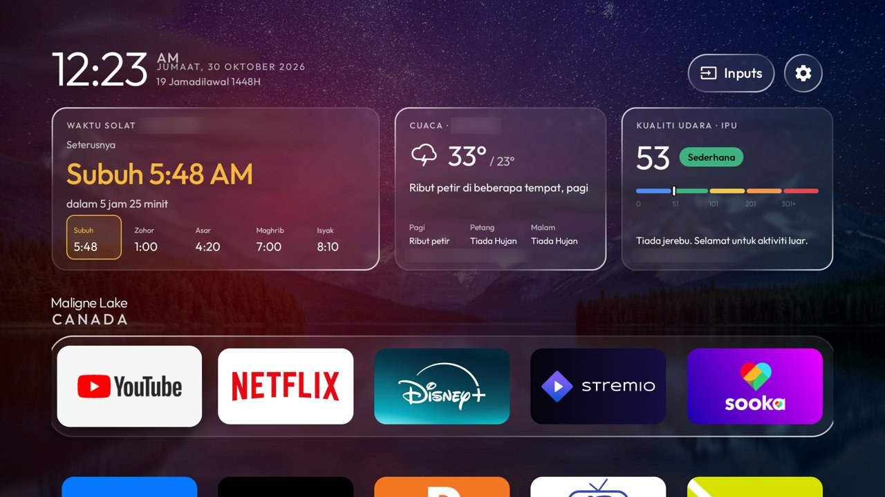
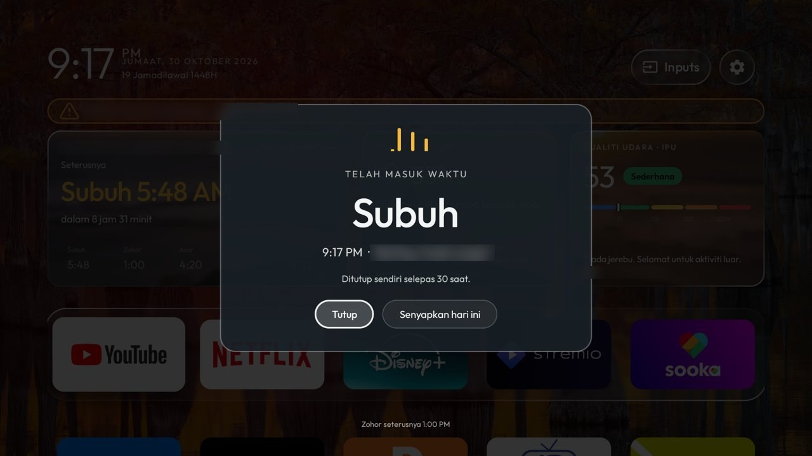
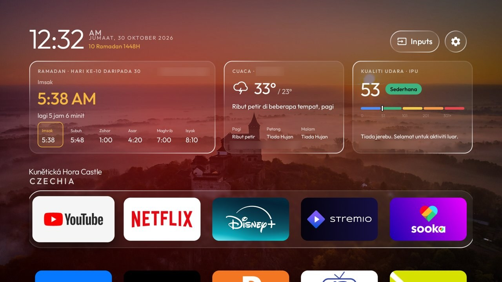
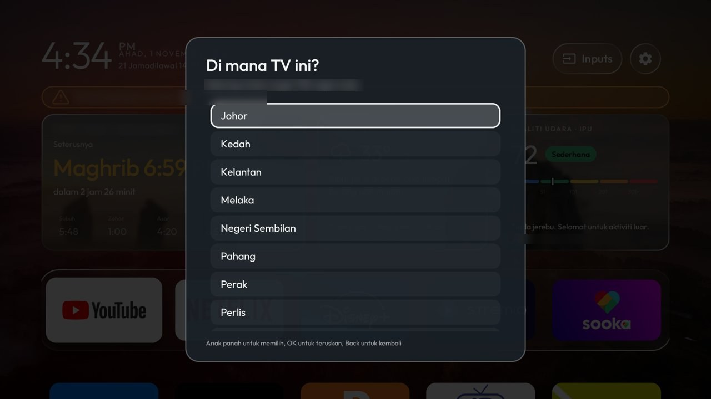
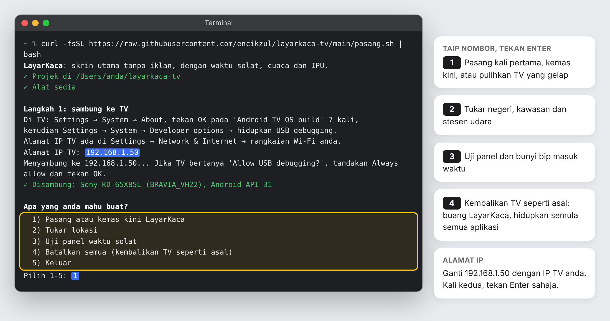
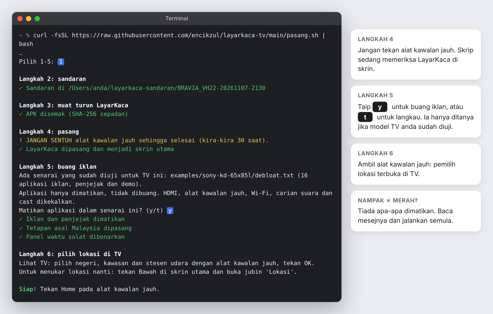

# LayarKaca

**Skrin utama Android TV dan Google TV tanpa iklan, dengan waktu solat JAKIM, cuaca MET Malaysia dan bacaan
jerebu JAS terus di depan mata.** Percuma, tanpa root, dan boleh dibatalkan bila-bila masa. Projek komuniti
yang dibina atas [Glass TV](https://github.com/cocombee/glass-tv), bukan keluaran rasmi Glass TV.



| | | |
|---|---|---|
|  |  |  |
| *Peringatan masuk waktu, walaupun tengah tengok Netflix* | *Mod Ramadan: kiraan berbuka dan imsak* | *Pilih lokasi dengan alat kawalan jauh* |

*Gambar dari Sony KD-65X85L. Nama lokasi dikaburkan.*

## Apa yang anda dapat

- **Waktu solat** ikut zon JAKIM anda: waktu seterusnya, kiraan masa, dan lima waktu hari ini
- **Peringatan masuk waktu**: panel dan bunyi bip 7 saat di atas apa sahaja yang ditonton; boleh disenyapkan
- **Mod Ramadan** yang hidup sendiri: kiraan ke berbuka dan imsak, waktu Imsak, hari ke berapa
- **Cuaca MET Malaysia** untuk daerah anda, dan **jalur amaran** bila ada amaran ribut di kawasan anda
- **Indeks Pencemar Udara (IPU)** stesen JAS terdekat, dan amaran jerebu bila melebihi 100
- **Tarikh dalam Bahasa Melayu** dan tarikh Hijri
- **Tiada iklan dan tiada "cadangan"**; aplikasi anda sendiri dalam dok, disusun dengan alat kawalan jauh

## Pasang dengan satu arahan

1. Di TV: **Settings → System → About**, tekan OK pada **Android TV OS build** 7 kali, kemudian
   **Developer options → USB debugging** → hidupkan. Catat alamat IP TV (**Settings → Network & Internet**).
2. Tampal satu arahan:
   - **Windows 10/11**: buka **PowerShell**

     ```powershell
     irm https://raw.githubusercontent.com/encikzul/layarkaca-tv/main/pasang.ps1 | iex
     ```

   - **Mac, Linux, Chromebook**: buka **Terminal** (telefon Android: Termux, eksperimen)

     ```bash
     curl -fsSL https://raw.githubusercontent.com/encikzul/layarkaca-tv/main/pasang.sh | bash
     ```

3. Taip IP TV, tekan **Allow** di TV, pilih **1**, dan jangan sentuh alat kawalan jauh sehingga **Siap!**
4. Pilih negeri, kawasan dan stesen udara di TV.

**Apa yang anda akan nampak.** Taip nombor pilihan dan tekan Enter:



Selepas memilih **1**, skrip berjalan sendiri sehingga **Siap!**:



*Pada Windows, tetingkap PowerShell berwarna biru dan tanda ✓ ditulis [OK]; pilihan dan langkahnya sama.*

Arahan yang sama juga menukar lokasi, menguji panel waktu solat dan **membatalkan semuanya**.
Panduan penuh, langkah manual, senarai zon dan stesen, dan penyelesaian masalah: **[README-MY.md](README-MY.md)**.

## TV yang boleh

Android TV atau Google TV, Android 8 ke atas: Sony, TCL, Xiaomi, Philips, Sharp, kebanyakan Hisense,
Chromecast with Google TV, Mi Box. **Tidak boleh:** Samsung, LG, Roku, VIDAA. Untuk TV itu, pasang
Chromecast with Google TV di port HDMI. Senarai model yang diuji: [docs/DEVICES.md](docs/DEVICES.md).

APK di halaman [Releases](../../releases) dibina oleh GitHub Actions terus daripada kod ini, dengan SHA-256 dan
sijil tandatangan (`CN=LayarKaca`) untuk disemak.

## Kemas kini

**7 November 2026: pemasang lebih selamat.** Pada sesetengah TV (contohnya Xiaomi Mi Box S), pemasang lama boleh
menyebabkan skrin gelap: iklan dibuang dahulu, kemudian jika pemasangan gagal, TV tiada skrin utama. Kini:

- iklan hanya dibuang **selepas** LayarKaca berjaya menjadi skrin utama;
- pemasang mengesan skrin gelap dan menghidupkan semula skrin utama asal sendiri;
- penyelamat skrin ditukar kepada jam LayarKaca bila penyelamat skrin Google dimatikan.

TV anda gelap selepas memasang? Jalankan semula arahan di atas dan pilih **1** (pasang semula) atau **4**
(kembalikan TV seperti asal). Butiran: [Skrin TV gelap selepas memasang](README-MY.md#skrin-tv-gelap-selepas-memasang).

**1 November 2026: v1.0.** Nama baharu LayarKaca (dahulu Glass TV Malaysia).

## Kredit

LayarKaca dibina atas **[Glass TV](https://github.com/cocombee/glass-tv)** oleh cocombee, yang dibina atas
**[CleanYourTV](https://github.com/Gathin23/cleanyourtv)** oleh Gathin. Lesen MIT ([LICENSE](LICENSE)). Sejarah
commit mereka dikekalkan dalam repo ini sebagai kredit; README asal ada di [README-GLASS-TV.md](README-GLASS-TV.md).
Data: JAKIM (melalui [api.waktusolat.app](https://api.waktusolat.app)), MET Malaysia (melalui
[data.gov.my](https://data.gov.my)), Jabatan Alam Sekitar ([APIMS](https://eqms.doe.gov.my/APIMS/main)).
Projek ini tidak berkaitan dengan JAKIM, MET Malaysia, JAS, Sony atau Google.

---

*English: LayarKaca is an ad-free home screen for Android TV and Google TV with JAKIM prayer times,
MET Malaysia weather and warnings, the DOE air pollutant index and a Ramadan mode. It is a fork of
[cocombee/glass-tv](https://github.com/cocombee/glass-tv); the original English documentation is in
[README-GLASS-TV.md](README-GLASS-TV.md).*
